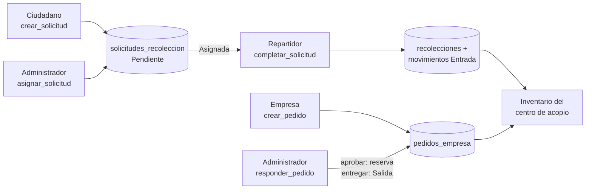
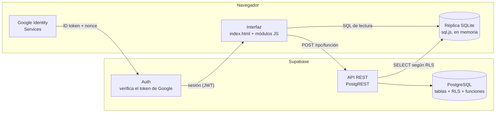
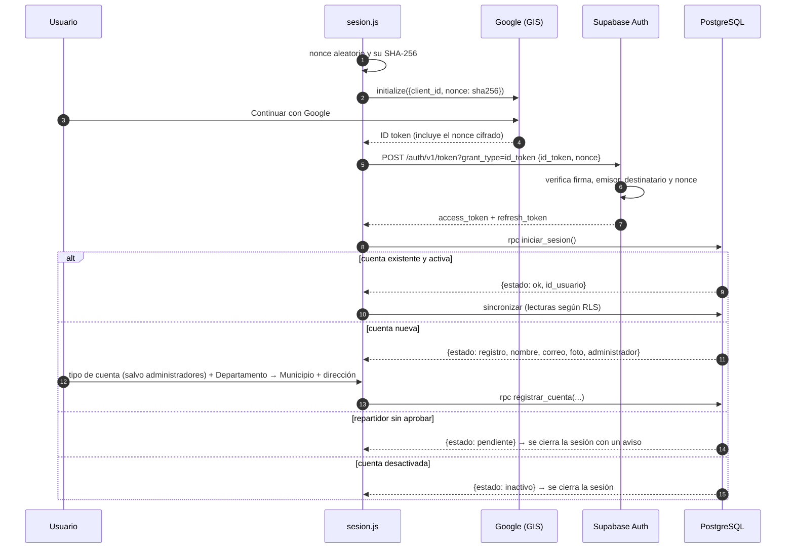
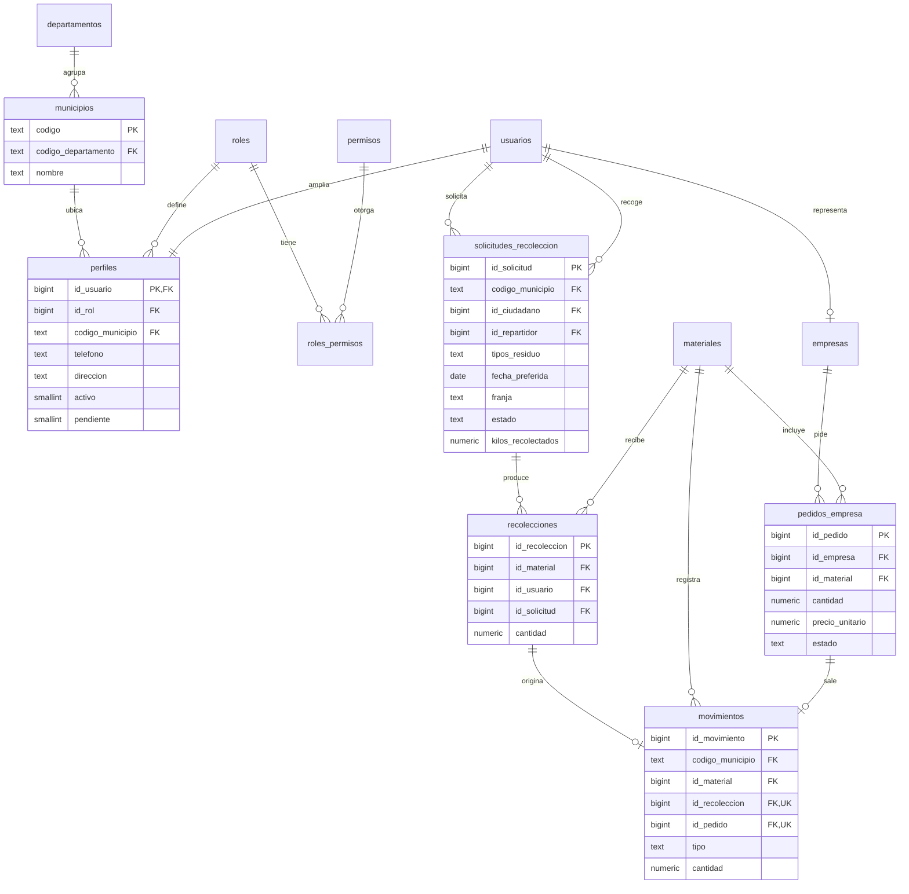

# Guía para desarrolladores · EcoGestión

Documento técnico para quien mantenga o extienda EcoGestión: arquitectura, modelo de datos, seguridad, convenciones y cómo agregar funcionalidades. El manual para usuarios finales está en [`ayuda.html`](../ayuda.html) y la puesta en marcha en el [README](../README.md).

**Contenido**
1. [Visión general](#1-visión-general)
2. [Estructura del código](#2-estructura-del-código)
3. [Inicio de sesión](#3-inicio-de-sesión)
4. [Sincronización y réplica SQLite](#4-sincronización-y-réplica-sqlite)
5. [Modelo de datos](#5-modelo-de-datos)
6. [Seguridad](#6-seguridad)
7. [Funciones del servidor (RPC)](#7-funciones-del-servidor-rpc)
8. [Patrones del cliente](#8-patrones-del-cliente)
9. [Cómo agregar una funcionalidad](#9-cómo-agregar-una-funcionalidad)
10. [Cambios de esquema](#10-cambios-de-esquema)
11. [Configuración, entornos y despliegue](#11-configuración-entornos-y-despliegue)
12. [Pruebas](#12-pruebas)
13. [Convenciones](#13-convenciones)
14. [Limitaciones conocidas y trabajo futuro](#14-limitaciones-conocidas-y-trabajo-futuro)
15. [Solución de problemas](#15-solución-de-problemas)

---

## 1. Visión general

EcoGestión es una aplicación web **estática** (HTML, CSS y JavaScript sin frameworks ni paso de compilación) respaldada por **Supabase**, para la **gestión municipal de residuos aprovechables**. Desde la versión 5 hay cuatro tipos de cuenta (administrador de un municipio, ciudadano, repartidor y empresa recicladora) y varios municipios conviven en la misma base, aislados entre sí.



Arquitectura:



**Decisiones de diseño**

| Decisión | Motivo |
|---|---|
| **Réplica SQLite local para leer** | Conserva el diseño académico original: todas las consultas, filtros y reportes son SQL sobre SQLite (sql.js). La interfaz no espera a la red para filtrar ni ordenar. |
| **Escrituras solo por funciones del servidor** | Cada operación valida permisos y datos en un único lugar confiable y es atómica. Las tablas no tienen políticas de escritura. |
| **Supabase Auth con el token de Google** | La firma del token se verifica en el servidor; el navegador nunca maneja secretos. |
| **Cliente REST propio (`nube.js`)** | Sin dependencias ni CDN de terceros para los datos. Son unas 200 líneas, fáciles de leer y de probar contra PostgREST local. |
| **Sin frameworks ni bundler** | Requisito del proyecto. Se abre en IntelliJ y se publica en GitHub Pages tal como está. |

---

## 2. Estructura del código

```
index.html               Todas las vistas, modales y la pantalla de acceso (una sola página)
ayuda.html               Manual de usuario
css/estilos.css          Diseño base (tokens de color en :root)
css/componentes.css      Componentes de acceso, solicitudes, rutas, pedidos y administración
css/ayuda.css            Estilos del manual
supabase/esquema_supabase.sql   Base central: limpieza de v4, tablas, triggers, RLS, funciones, catálogos y DIVIPOLA
database/esquema.sql            Esquema SQLite del centro de acopio (réplica)
database/esquema_municipal.sql  Esquema SQLite de cuentas, solicitudes, empresas y pedidos (réplica)
datos/divipola.csv              Departamentos y municipios del DANE (fuente de lugares.js y del bloque DIVIPOLA)
js/…                     Ver tabla
pruebas/                 Supabase simulado + pruebas SQL y de navegador
herramientas/            generar_datos_sql.js (regenera datos_sql.js, lugares.js y el bloque DIVIPOLA del esquema)
img/ayuda/               Capturas del manual
```

Los scripts se cargan en este orden (`index.html`, al final del `<body>`); cada uno registra un objeto en `window.Eco`:

| Archivo | Objeto | Responsabilidad |
|---|---|---|
| `lib/sql-asm.js` | `initSqlJs` | Motor SQLite compilado a JavaScript (asm.js, funciona incluso con `file://`) |
| `utilidades.js` | `Eco.Util` | Formatos (números, fechas, dinero), CSV, errores de campo, avisos, `mensajeError` |
| `lugares.js` | `Eco.Lugares` | DIVIPOLA embebida: `DEPARTAMENTOS`, `municipiosDe(dep)`, `municipio(cod)`, `nombre(cod)` → "Soacha, Cundinamarca" |
| `comun.js` | `Eco.Comun` | `CATEGORIAS`, `dinero`, `precio`, `cantidad`, `estado`, `insigniaTipo(s)`, `leerCantidad`, `leerPrecio`, `contacto`, `fechaCorta`, `prepararLugares(idDep, idMun)` |
| `datos_sql.js` | `Eco.SQL` | Copia embebida de `database/*.sql` para crear la réplica |
| `database.js` | `Eco.DB` | Réplica: `iniciar`, `cargarReplica`, `consultar`, `consultarUno`, `escalar`, `contar`, `exportar` |
| `materiales.js` … `panel.js` | `Eco.Materiales`, `Eco.Recolecciones`, `Eco.Inventario`, `Eco.Historial`, `Eco.Reportes`, `Eco.Panel` | Centro de acopio |
| `config.js` | `Eco.Config` | Client ID de Google, URL y clave pública de Supabase |
| `nube.js` | `Eco.Nube` | Auth, `rpc`, `sincronizar` |
| `sesion.js` | `Eco.Sesion` | Google, registro, permisos, menú por rol, revalidación |
| `solicitudes.js` | `Eco.Solicitudes` (+ `.ciudadano`, `.repartidor`) | Vistas *Solicitudes* (administrador), *Mis solicitudes* y *Mis rutas*; modales de solicitud, asignación y registro de kilos |
| `pedidos.js` | `Eco.Pedidos` (+ `.empresa`) | *Pedidos de empresas* (administrador) y *Panel empresarial* |
| `perfil.js`, `administracion.js` | `Eco.Perfil`, `Eco.Administracion` | Perfil propio; cuentas y estadísticas del municipio |
| `app.js` | `Eco.App` | Arranque, navegación, modales, `confirmar`, `pedirTexto`, contadores del menú, `despuesDeCambio`, actualización periódica |

---

## 3. Inicio de sesión



- La sesión (tokens) se guarda en `localStorage` (`ecogestion_supabase_sesion`). `Eco.Nube.asegurarToken()` la renueva cuando le quedan menos de 90 s.
- Al recargar, `Eco.Sesion.iniciar()` restaura la sesión y vuelve a llamar `iniciar_sesion()`.
- `Eco.Sesion.revalidar()` se ejecuta después de cada sincronización: si la cuenta fue desactivada se cierra la sesión, y si cambió su tipo se aplican los nuevos permisos.
- Cerrar sesión llama `/auth/v1/logout`, borra los tokens y recarga la página para no dejar datos en pantalla.

---

## 4. Sincronización y réplica SQLite

`Eco.Nube.sincronizar()`:

1. Para cada tabla de `Eco.DB.TABLAS_REPLICA`, pide **solo las columnas que existen en la réplica** (`Eco.DB.columnas(tabla)`), de 1000 en 1000 filas (`Range`). Así nunca se descargan columnas internas como `usuarios.auth_id`.
2. Las 12 fuentes (11 tablas y la vista `existencias_municipio`) se piden en paralelo; RLS decide qué filas llegan. `departamentos` y `municipios` **no** se replican: el navegador usa `js/lugares.js`.
3. `Eco.DB.cargarReplica(datos)` construye una **base nueva** y solo al final reemplaza la anterior. Una descarga fallida no deja la réplica a medias.

En la réplica:
- Se eliminan los triggers: las reglas ya se aplicaron en el servidor.
- `PRAGMA foreign_keys = OFF`: la cuenta puede no ver todas las filas referenciadas (por ejemplo, una empresa no ve `movimientos` ni a los repartidores).
- Se inserta con `INSERT OR IGNORE`; si una fila no cumple un `CHECK` local se omite y se avisa en la consola.

**Cuándo se sincroniza:** al iniciar sesión, después de cada operación (`Eco.App.despuesDeCambio`), cada 30 s si la pestaña está visible y no hay un modal abierto, al volver a la pestaña (`focus`) y con el botón *Sincronizar* (solo administradores).

**Tipos de datos:** PostgREST devuelve `numeric` como número JSON, `date` como `AAAA-MM-DD` y `timestamp` como `AAAA-MM-DDTHH:MM:SS.ffffff`. Los timestamps se guardan en **hora de Bogotá sin zona** (`now() at time zone 'America/Bogota'`), así coinciden con el formato que la interfaz ya usaba con SQLite.

---

## 5. Modelo de datos



Notas:
- **Municipio:** el código DANE de 5 dígitos (`municipios.codigo`) aparece en `perfiles`, `materiales`, `solicitudes_recoleccion`, `recolecciones`, `movimientos` y `pedidos_empresa`. Es lo que usan las políticas y funciones para aislar los municipios. Las áreas no municipalizadas de Amazonas, Guainía y Vaupés están incluidas porque DIVIPOLA las codifica igual.
- **`usuarios.rol`** conserva su significado original (`Administrador`/`Operador`). El **tipo de cuenta** es `perfiles.id_rol`. Las funciones mantienen ambos sincronizados.
- **`perfiles.pendiente = 1`**: repartidor recién registrado (siempre con `activo = 0`, `chk_perfil_pendiente`). Aprobar es `admin_estado_usuario(id, true)`.
- **`tipos_residuo`** se guarda como texto (`"Papel y cartón, Plástico"`) con las mismas categorías de `materiales.categoria`: así se replica sin conversiones. La función valida cada valor.
- **Inventario:** las existencias no se almacenan. La réplica del administrador las calcula con `vista_existencias`; el servidor expone `existencias_municipio` (existencia y `comprometido` = pedidos *Aprobado*) para quienes no pueden leer `movimientos`.
- **Entradas y salidas:** una entrada siempre nace de una recolección (`id_recoleccion`); una salida puede venir de un pedido entregado (`id_pedido`) o ser manual. `chk_movimiento_origen` lo garantiza.
- **Triggers en PostgreSQL:** `trg_movimiento_validar` (unidad y municipio coinciden con el material; una salida no supera las existencias), `trg_solicitud_estado` y `trg_pedido_estado` (transiciones válidas).

---

## 6. Seguridad

### Capas

| Capa | Qué protege |
|---|---|
| Supabase Auth | Identidad: verifica la firma del token de Google y el nonce |
| `GRANT` | `anon` no tiene acceso a nada. `authenticated` solo puede hacer `SELECT` en las tablas y ejecutar las funciones listadas |
| RLS (lectura) | Qué filas ve cada cuenta, siempre dentro de su municipio (tabla siguiente) |
| Funciones `security definer` | Únicas que escriben. Empiezan con `exigir('permiso')` y validan municipio, propiedad y estado |
| Constraints y triggers | Integridad aunque una función tuviera un error |
| Interfaz (`data-permiso`, `Eco.Sesion.exigir`) | Solo comodidad: oculta opciones. **No** es una barrera de seguridad |

### Políticas de lectura (RLS)

| Tabla | Quién puede leer |
|---|---|
| `departamentos`, `municipios` | Cualquiera (también `anon`) |
| `roles`, `permisos`, `roles_permisos` | Cualquier sesión |
| `usuarios`, `perfiles` | `puede_ver_usuario(id)`: uno mismo; el administrador, todo su municipio; todos, a los administradores de su municipio; ciudadano y repartidor de una misma solicitud, entre sí |
| `materiales`, vista `existencias_municipio` | Cuentas activas del mismo municipio |
| `solicitudes_recoleccion` | El ciudadano que la creó, el repartidor asignado y el administrador del municipio (`solicitudes.gestionar`) |
| `recolecciones` | El administrador del municipio y el repartidor que la registró |
| `movimientos` | Solo el administrador del municipio (`inventario.gestionar`) |
| `empresas` | La propia empresa y el administrador del municipio |
| `pedidos_empresa` | La empresa que lo hizo y el administrador del municipio (`pedidos.gestionar`) |
| `correos_administradores` | Nadie desde la API |

### Funciones auxiliares

- `yo()`: el `id_usuario` de la sesión actual, solo si está activa.
- `tiene_permiso(codigo)`: consulta `roles_permisos` del rol de la cuenta.
- `exigir(codigo)`: lanza "No tienes permiso…" si no se tiene el permiso, y devuelve `yo()`.
- `mi_municipio()`, `municipio_de(id_usuario)`: código DANE de la cuenta actual o de otra.
- `es_admin_de(municipio, permiso)`: tiene el permiso **y** es de ese municipio. Es la comprobación clave para que un administrador no toque otro municipio.
- `existencia_material(id)`, `comprometido_material(id)`, `cantidad_texto(n)`: cálculos de inventario y formato para los mensajes.

Todas son `security definer` con `set search_path = public`, para evitar la sustitución de objetos por `search_path`.

La vista `existencias_municipio` se ejecuta con los permisos de su dueño (no de quien consulta) y filtra con `mi_municipio()`, así una empresa ve cuánto hay sin leer `movimientos`.

### Datos que nunca van al navegador
El *client secret* de Google (solo en Supabase → Providers), la `service_role`/`secret` key de Supabase y la contraseña de la base. En `config.js` solo hay datos públicos por diseño: el Client ID y la clave *publishable/anon*, que es segura porque todo está protegido por RLS y `GRANT`.

---

## 7. Funciones del servidor (RPC)

Se llaman con `await Eco.Nube.rpc('nombre', { p_param: valor })`. Si fallan, lanzan un `Error` con `mensajeServidor` en español, que `Eco.Util.mensajeError` muestra tal cual.

| Función | Permiso | Parámetros | Efecto |
|---|---|---|---|
| `iniciar_sesion()` | sesión | — | `{estado: ok\|registro\|pendiente\|inactivo}`. En `registro` incluye `administrador: true/false`. Actualiza la foto y el último acceso |
| `registrar_cuenta` | sesión sin cuenta | `p_tipo, p_codigo_municipio, p_direccion, p_telefono, p_razon_social, p_nit` | Crea `usuarios` + `perfiles` (+ `empresas`). Los correos autorizados quedan como `administrador` sin importar `p_tipo`; los repartidores quedan pendientes. Devuelve `{estado: ok\|pendiente}` |
| `actualizar_perfil` | `perfil.editar` | `p_telefono, p_direccion` | Dirección obligatoria para ciudadanos; teléfono para repartidores |
| `crear_solicitud` | `solicitudes.crear` | `p_direccion, p_tipos text[], p_descripcion, p_cantidad_estimada, p_fecha_preferida, p_franja` | Fecha entre hoy y 60 días; máximo 3 abiertas por ciudadano |
| `cancelar_solicitud` | ciudadano dueño o administrador | `p_id, p_motivo` | Solo Pendiente/Asignada |
| `asignar_solicitud` | `solicitudes.gestionar` | `p_id, p_id_repartidor` | Repartidor activo del mismo municipio; sirve también para reasignar |
| `rechazar_solicitud` | `solicitudes.gestionar` | `p_id, p_motivo` | Motivo obligatorio |
| `devolver_solicitud` | `recolecciones.realizar` | `p_id, p_motivo` | Asignada → Pendiente, quita al repartidor |
| `completar_solicitud` | repartidor asignado o administrador | `p_id, p_detalle jsonb` (`[{id_material, cantidad}]`), `p_observaciones` | Por cada material: recolección + movimiento de entrada. Devuelve los kilos |
| `guardar_material`, `eliminar_material` | `inventario.gestionar` | como antes | Siempre en `mi_municipio()`; nombre único por municipio |
| `registrar_recoleccion` | `inventario.gestionar` | `p_id_material, p_id_responsable, p_cantidad, p_fecha, p_observaciones` | Responsable: administrador o repartidor activo del municipio |
| `registrar_salida` | `inventario.gestionar` | ídem | No puede usar lo comprometido en pedidos aprobados |
| `guardar_empresa` | `empresa.gestionar` | `p_razon_social, p_nit, p_telefono, p_correo, p_direccion, p_descripcion` | Crea o actualiza (`on conflict`) |
| `crear_pedido` | `pedidos.crear` | `p_id_material, p_cantidad, p_precio, p_mensaje` | Cantidad ≤ existencia − comprometido; un pendiente por material |
| `responder_pedido` | según la acción | `p_id, p_accion` (`aprobar`\|`rechazar`\|`entregar`\|`cancelar`), `p_respuesta` | Aprobar reserva; entregar crea la salida; cancelar solo la empresa |
| `admin_estado_usuario` | `usuarios.gestionar` | `p_id, p_activo` | Solo su municipio; aprueba pendientes; desactivar un repartidor libera sus asignadas |
| `admin_rol_usuario` | `usuarios.gestionar` | `p_id, p_rol` (`ciudadano`\|`repartidor`\|`administrador`) | Las empresas no cambian de tipo; siempre queda un administrador activo por municipio |

Bloqueos: las funciones que cambian estados o cantidades usan `select … for update` sobre la solicitud, el pedido o el material, así dos administradores no pueden aprobar a la vez más material del que hay.

---

## 8. Patrones del cliente

### Módulo típico

```js
(function () {
    'use strict';
    const Eco = window.Eco = window.Eco || {};

    function render() {
        if (!Eco.Sesion.puedeVerVista('mi-vista')) return;      // solo si la cuenta puede verla
        const filas = Eco.DB.consultar('SELECT … WHERE x = ?', [valor]);   // SIEMPRE parametrizado
        document.getElementById('tabla-body').innerHTML =
            filas.map((f) => `<tr><td>${Eco.Util.escaparHtml(f.nombre)}</td></tr>`).join('');
    }

    async function guardar(evento) {
        evento.preventDefault();
        // 1) Validar en el cliente (mensajes junto a cada campo)
        // 2) Escribir en el servidor
        try {
            await Eco.Nube.rpc('mi_funcion', { p_dato: dato });
            Eco.App.cerrarModal('modal-x');
            await Eco.App.despuesDeCambio('Guardado.');            // sincroniza y redibuja todo
        } catch (error) {
            Eco.Util.mostrarAviso(Eco.Util.mensajeError(error, 'No se pudo guardar.'), 'error');
        }
    }

    function init() { /* listeners; se llama una vez al arrancar */ }
    Eco.MiModulo = { init, render };
})();
```

Reglas:
- **`render()` solo lee la réplica** y es idempotente. `Eco.App.refrescarTodo()` lo llama en todos los módulos permitidos.
- **Toda escritura va por `Eco.Nube.rpc`**, seguida de `Eco.App.despuesDeCambio(mensaje)`.
- **Validar dos veces:** en el cliente para dar mensajes claros por campo, y en el servidor como garantía.
- **Escapar todo** lo que va a `innerHTML` con `Eco.Util.escaparHtml`.
- **Delegación de eventos:** las tablas usan `data-accion` y `data-id` con un listener en el `tbody`, sin `onclick` en el HTML.

### Permisos en la interfaz

- `data-permiso="perm1 perm2"` en cualquier elemento lo oculta si la cuenta no tiene ninguno de esos permisos (`Eco.Sesion.aplicarPermisosUI`).
- `PERMISOS_VISTA` en `sesion.js` relaciona cada vista con sus permisos; `Eco.App.irA` no abre vistas no permitidas.

### Modales y confirmaciones

- Los modales se declaran en `index.html` (`.modal-fondo`) y se abren con `Eco.App.abrirModal(id)`. Los botones con `data-cerrar-modal="id"` los cierran.
- Para confirmar: `if (await Eco.App.confirmar({ titulo, mensaje, textoConfirmar, peligro })) { … }`.
- Para pedir un motivo: `const motivo = await Eco.App.pedirTexto({ titulo, mensaje, campo, obligatorio, textoConfirmar })`. Devuelve el texto, o `null` si la persona cierra la ventana.
- Selectores de lugar: `Eco.Comun.prepararLugares('id-departamento', 'id-municipio')` llena el departamento y carga los municipios al cambiarlo.

---

## 9. Cómo agregar una funcionalidad

### Ejemplo A: el administrador puede cambiar la fecha de una solicitud (sin cambiar tablas)

1. **Servidor:** crea `supabase/migraciones/001_reprogramar.sql`:
   ```sql
   create or replace function public.reprogramar_solicitud(p_id bigint, p_fecha date) returns void
   language plpgsql security definer set search_path = public as $$
   begin
       perform exigir('solicitudes.gestionar');
       if p_fecha is null or p_fecha < hoy_bogota() then raise exception 'Elige una fecha desde hoy.'; end if;
       update solicitudes_recoleccion set fecha_preferida = p_fecha
        where id_solicitud = p_id and codigo_municipio = mi_municipio() and estado in ('Pendiente', 'Asignada');
       if not found then raise exception 'La solicitud no existe o ya está cerrada.'; end if;
   end $$;
   revoke execute on function public.reprogramar_solicitud(bigint, date) from public, anon;
   grant execute on function public.reprogramar_solicitud(bigint, date) to authenticated;
   ```
   Ejecútalo en el SQL Editor de Supabase y agrega la misma función a `esquema_supabase.sql` (y su nombre a la lista de la sección 0) para instalaciones nuevas.
2. **Cliente:** en `solicitudes.js → renderAdmin`, agrega un botón `data-accion="reprogramar"`; en `manejarAccion`, una función que pida la fecha y llame `await Eco.Nube.rpc('reprogramar_solicitud', { p_id, p_fecha })` y luego `Eco.App.despuesDeCambio(…)`.
3. **Pruebas:** agrega a `pruebas/prueba_sql.sh` que un ciudadano reciba "No tienes permiso" y que el administrador de otro municipio no la encuentre.

### Ejemplo B: una tabla nueva

1. Crea la tabla en una migración de Supabase con su RLS (`enable row level security` + política `for select`), `grant select … to authenticated` y las funciones que la escriban.
2. Agrega la tabla equivalente en SQLite a `database/esquema_municipal.sql` (o `esquema.sql`) y regenera `js/datos_sql.js` con `node herramientas/generar_datos_sql.js`.
3. Agrega su nombre a `TABLAS_REPLICA` en `js/database.js`, respetando el orden de dependencias.
4. Si tiene una vista propia: agrega la `<section class="vista" id="vista-x">` en `index.html`, el ítem de menú con `data-permiso`, la entrada en `PERMISOS_VISTA` (`sesion.js`), el módulo en `refrescarTodo` (`app.js`) y su `init()` en `Eco.App.iniciar`.

### Agregar un permiso o cambiar los de un rol

```sql
insert into permisos (codigo, descripcion) values ('reportes.consultar', 'Ver los reportes del centro de acopio');
insert into roles_permisos (id_rol, id_permiso)
select r.id_rol, p.id_permiso from roles r, permisos p
where r.codigo = 'repartidor' and p.codigo = 'reportes.consultar';
```

La interfaz lee los permisos de la réplica, así que el cambio se aplica en la siguiente sincronización.

---

## 10. Cambios de esquema

- **Supabase:** `esquema_supabase.sql` empieza borrando las tablas (sección 0), así que **ejecutarlo sobre una base con datos los borra**. Sirve para instalar o para pasar de la versión 4 a la 5. Escribe migraciones incrementales en `supabase/migraciones/NNN_descripcion.sql` (`alter table`, `create or replace function`…), ejecútalas en orden en el SQL Editor e incorpóralas también a `esquema_supabase.sql`.
- **Réplica SQLite:** `js/datos_sql.js` es una copia de `database/esquema.sql` y `database/esquema_municipal.sql`, embebida porque el navegador no permite leer `.sql` con `fetch()` desde `file://`. Después de editar los `.sql`, regenérala:
  ```bash
  node herramientas/generar_datos_sql.js
  ```
- Las columnas que existan en Supabase pero no en la réplica simplemente no se descargan. Para mostrarlas, agrégalas también a la réplica.
- **Municipios:** si el DANE crea o renombra uno, edita `datos/divipola.csv` y ejecuta `node herramientas/generar_datos_sql.js` (actualiza `js/lugares.js` y el bloque `DIVIPOLA` del esquema). En una base existente agrega la fila con `insert into municipios values ('CÓDIGO', 'DEP', 'Nombre');`.

---

## 11. Configuración, entornos y despliegue

| Entorno | Dirección | Requisitos |
|---|---|---|
| Local (IntelliJ) | `http://localhost:63342/SistemaGestionResiduos/index.html` | Origen autorizado en Google: `http://localhost` y `http://localhost:63342` |
| Producción | `https://ryuuga-code.github.io/EcoGestion/` | Origen autorizado: `https://ryuuga-code.github.io` |
| Pruebas | `http://localhost:8800` | Ver `pruebas/README.md` |

`js/config.js`:

```js
GOOGLE_CLIENT_ID: '…apps.googleusercontent.com',
SUPABASE_URL: 'https://<proyecto>.supabase.co',
SUPABASE_ANON_KEY: 'sb_publishable_…'      // o la clave anon (eyJ…)
```

**Supabase:** proveedor Google activo con el Client ID (y el secreto de Google), esquema creado con `supabase/esquema_supabase.sql`. Los administradores iniciales están en `correos_administradores`; cada uno elige su municipio al registrarse.

**Despliegue:** GitHub Pages publica la rama `main` desde la raíz. Cada `git push` a `main` se publica en uno o dos minutos. Los navegadores pueden conservar JavaScript en caché: pide a los usuarios **Ctrl + F5** tras cambios grandes, o agrega un sufijo de versión a los `<script src="js/x.js?v=5">`.

---

## 12. Pruebas

Ver [`pruebas/README.md`](../pruebas/README.md). Resumen:

- `pruebas/prueba_sql.sh`: funciones y RLS actuando como siete usuarios de dos municipios (administradores, ciudadanos, repartidor, empresa e intruso).
- `pruebas/prueba_e2e.js`: 44 comprobaciones en cinco navegadores simultáneos: registro con DIVIPOLA, aprobación del repartidor, solicitud → asignación → kilos → inventario, pedido → aprobación → entrega, aislamiento entre municipios, permisos, desactivación y persistencia de la sesión.

Antes de publicar un cambio en las funciones del servidor, ejecuta ambas pruebas sobre una base local recién creada.

---

## 13. Convenciones

- **Idioma:** nombres de variables, funciones, tablas, columnas y mensajes en español, sin abreviaturas crípticas.
- **JavaScript:** IIFE con `'use strict'`, un objeto por módulo en `window.Eco`, 4 espacios, comillas simples, `const`/`let`, `async/await`.
- **SQL:** palabras clave en mayúsculas en SQLite y en minúsculas en PostgreSQL (como en cada archivo); siempre consultas parametrizadas (`?` en la réplica, parámetros `p_…` en las funciones).
- **Mensajes:** en segunda persona, concretos y con la solución ("La cantidad no puede superar lo disponible (40 kg).").
- **CSS:** tokens de `:root` en `estilos.css`; los componentes nuevos van en `componentes.css`. No uses colores sueltos fuera de los tokens, salvo las insignias por tipo de residuo.
- **Accesibilidad:** `aria-label` en botones con solo un icono, foco visible, `aria-live` en los contadores, contraste AA.

---

## 14. Limitaciones conocidas y trabajo futuro

| Tema | Situación | Mejora posible |
|---|---|---|
| Actualización | Consulta cada 30 s (polling) | Supabase Realtime para recibir los cambios al instante |
| Volumen | Cada sincronización descarga todo lo visible | Sincronización incremental por `fecha_actualizacion`, o consultas paginadas en el servidor para los listados grandes |
| Rutas | Las solicitudes se ordenan por fecha y franja | Mapa con la ruta del día (geocodificación de direcciones) |
| Notificaciones | El ciudadano ve el cambio de estado al entrar | Correo o WhatsApp al asignar y al recolectar |
| Fotos | Las solicitudes no llevan foto | Reutilizar Supabase Storage para una foto del material separado |
| Cambio de municipio | Solo por SQL | Función administrativa que traslade la cuenta sin mezclar historiales |
| Cuentas | No hay eliminación desde la interfaz (solo desactivar) | Función `admin_eliminar_cuenta` que anonimice los datos personales |
| Centro de acopio | No se editan ni anulan recolecciones o salidas | Movimientos de ajuste con justificación |
| Abuso | Máximo 3 solicitudes abiertas por ciudadano | Límites de Supabase / Edge Functions |
| CI | Las pruebas se ejecutan a mano | GitHub Actions con un servicio de PostgreSQL |

---

## 15. Solución de problemas

| Síntoma | Causa | Solución |
|---|---|---|
| `Could not find the function public.x(...) in the schema cache` | Función nueva o con otra firma | En el SQL Editor: `notify pgrst, 'reload schema';` y revisa los nombres de los parámetros (`p_…`) |
| `permission denied for function x` | Falta el `grant execute … to authenticated` | Agrégalo en la migración |
| `permission denied for table x` (42501) en un `SELECT` | Falta el `grant select` o la política RLS | `grant select on x to authenticated` y crea la política |
| La consulta devuelve 0 filas sin error | RLS filtró todo | Revisa la política y que la cuenta esté activa (`yo()` no nulo) |
| "Nonces mismatch" | El nonce enviado no es el que se dio a GIS | No reutilices un token; `prepararGoogle()` genera un nonce nuevo en cada intento |
| "Supabase rechazó el inicio con Google" | Proveedor Google desactivado o Client ID no listado | Authentication → Providers → Google |
| Google "no registered origin" | Origen no autorizado | Google Cloud → Clients → Orígenes autorizados de JavaScript |
| "Réplica: N filas no cumplieron el esquema local" (consola) | Un `CHECK` de SQLite es más estricto que el de PostgreSQL | Alinea las restricciones de `database/*.sql` con las de `esquema_supabase.sql` |
| Cambios que no se ven tras publicar | Caché del navegador | Ctrl + F5 o versiona los `<script>` |
